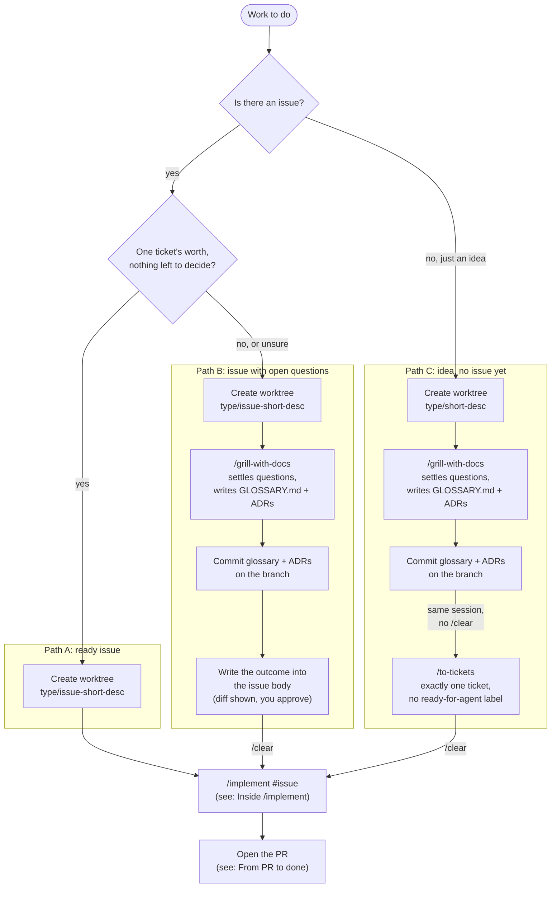
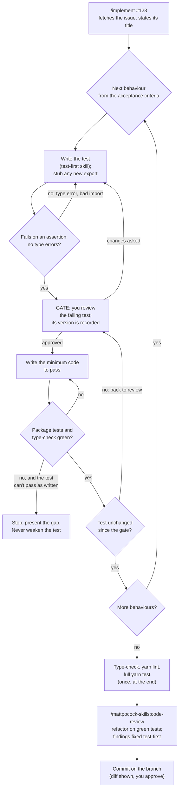
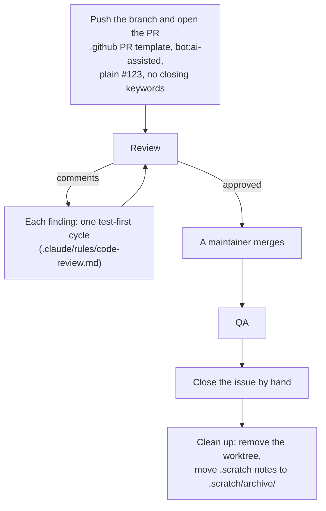

# Agentic workflow

How we build platform-js changes with Claude Code and [Matt Pocock's skills](https://github.com/mattpocock/skills). This
is the supported flow for this repo. It replaces the skills' own default flow (grill → spec → tickets → implement): we
never write a separate spec, and every change is one ticket.

Setup (plugins, permissions, skills): [`docs/ClaudeCode.md`](ClaudeCode.md). Branch names, commands and tests:
[`DEV_GUIDE.md`](../DEV_GUIDE.md).

## Rules that apply on every path

- **You approve every outward step.** Before any commit, push, PR, issue edit or comment, Claude shows the diff and the
  exact content and waits for your explicit "yes".
- **Test first, always.** Every behaviour change goes through the `test-first` skill: the test is written, seen failing
  for the right reason, and reviewed by you before any implementation. A failing test is never weakened.
- **One issue holds the plan.** Grill outcomes are written into the issue **body**, not added as comments, so the body
  is always the current plan. Body edits are shown as a diff first.
- **One change, one ticket.** If a change needs more than one ticket, split the idea into separate changes instead.
- **Issues and PRs** follow [`docs/agents/issue-tracker.md`](agents/issue-tracker.md) (plain `#123` links, no closing
  keywords, closed by hand after QA), with only the org labels in
  [`docs/agents/triage-labels.md`](agents/triage-labels.md). Never `ready-for-agent` or `ready-for-human`.

## Pick your path

When unsure whether an issue is ready, take Path B: a short grill costs less than building the wrong thing.

### Path A: ready issue

The issue already says what to build, with acceptance criteria and nothing left to decide.

1. Create the worktree, named `<type>/<issue>-<short-description>`: `wt switch --create chore/123-short-desc --no-cd`,
   or `git worktree add ../platform-js.chore-123-short-desc -b chore/123-short-desc`.
2. Start Claude in the worktree and run `/implement #123`.

### Path B: issue with open questions

1. Create the worktree as in Path A.
2. Run `/grill-with-docs` and point it at the issue. It interviews you until every question is settled, and writes new
   terms to `GLOSSARY.md` and decisions to `docs/decisions/` as ADRs (format:
   [`docs/agents/domain.md`](agents/domain.md)).
3. Commit the glossary and ADRs on the branch (`docs: ...`).
4. Ask Claude to write the outcome into the issue body: the settled decisions (one line each, linking any ADR),
   acceptance criteria, and out of scope. Claude shows the old and new body as a diff, and edits it only after your yes.
   No comments.
5. `/clear`, then `/implement #123`. The issue body now holds everything the grill settled.

### Path C: idea, no issue yet

1. Create the worktree, named `<type>/<short-description>` (no issue number yet). Keep this branch name to the end.
2. Run `/grill-with-docs` with the idea. Commit the glossary and ADRs as in Path B.
3. In the **same session** (`/to-tickets` reads the conversation, so don't `/clear` first), run `/to-tickets`. When it
   shows its breakdown, make it **one** ticket, and tell it not to apply `ready-for-agent`. It creates the issue in the
   issue form's shape (title prefix, Issue Type, labels including `bot:ai-assisted`, form sections; see
   [`docs/agents/issue-tracker.md`](agents/issue-tracker.md)).
4. `/clear`, then `/implement #<new issue>`.

## Inside `/implement`

`/implement #123` fetches the issue, builds it test-first, reviews its own work, and commits. Our `test-first` skill
wraps the `tdd` step that `/implement` calls, so each behaviour stops at the gate for your review.

- The type-check command is in [`CLAUDE.md` → Build Commands](../CLAUDE.md#build-commands). It must show no errors, and
  CI fails a PR on any type error ([`DEV_GUIDE.md` → Continuous integration](../DEV_GUIDE.md#continuous-integration)).
- Because of the gate, `/implement` is not run unattended.

## From PR to done

## Which skills we use

| Skill                                         | Used?    | For                                                                         |
| --------------------------------------------- | -------- | --------------------------------------------------------------------------- |
| `/grill-with-docs`                            | Yes      | Paths B and C: settle open questions; writes `GLOSSARY.md` and ADRs         |
| `/to-tickets`                                 | Yes      | Path C only: turn a grilled idea into one issue                             |
| `/implement`                                  | Yes      | Every path: build one issue                                                 |
| `test-first` (this repo)                      | Yes      | Every behaviour change; wraps Matt's `tdd`                                  |
| `/mattpocock-skills:code-review`              | Yes      | Called by `/implement`; also on demand for a branch                         |
| `/triage`                                     | Yes      | Triage incoming issues, with the labels in `docs/agents/triage-labels.md`   |
| `/diagnosing-bugs`, `/prototype`, `/research` | Optional | Before a grill, when a bug or design question needs evidence first          |
| `/to-spec`                                    | No       | We never write a separate spec; the issue body is the spec                  |
| `/implement-spec`                             | No       | Runs tickets unattended through subagents, which the test-first gate blocks |
| `/wayfinder`                                  | No       | Its `wayfinder:*` labels don't exist on this repo                           |
